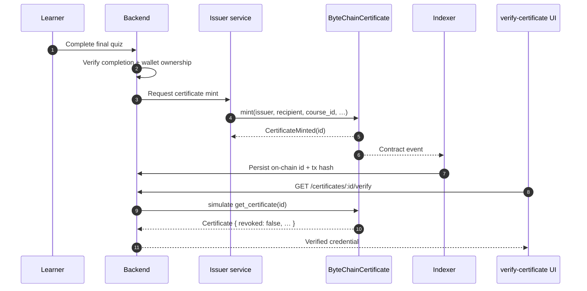

# Design: ByteChainCertificate (non-transferable credential on Soroban)

| | |
|---|---|
| **Status** | Draft for review |
| **Author** | temiport25 |
| **Issue** | [#2](https://github.com/WeAcademy/bytechain-contracts/issues/2) |
| **Contract** | `ByteChainCertificate` |
| **Target** | Stellar Soroban (Rust, `soroban-sdk` 29.x) |
| **Related** | ByteChainDAO, ByteChainToken, backend certificate module, `verify-certificate` frontend page, `bytechain-indexer` |

---

## 1. Summary

`ByteChainCertificate` is a Soroban contract that issues **non-transferable
credentials** ("soulbound" certificates) to learners who complete a ByteChain
Academy course. A certificate is minted once, bound permanently to the
recipient's Stellar address, and can be verified by anyone through a read-only
contract call.

The contract replaces the database-only certificate flow as the source of truth
for issued credentials while keeping the existing backend and frontend
experience. It deliberately does **not** implement a transfer entry point: no
account, issuer or admin can move a certificate from one address to another.
Revocation is the only lifecycle transition after issuance. (An audited code
upgrade could of course change the rules, which is why upgrades are timelocked
and reviewed; see §10.)

### Goals

- Mint a certificate to a verified Stellar address after course completion.
- Make non-transferability a property of the contract, not a policy.
- Provide cheap, permissionless verification by certificate ID or by
  `(recipient, course)` pair.
- Support issuer allowlisting, revocation, pagination and upgrades.
- Emit indexable events for `bytechain-indexer` and the backend.
- Keep personally identifiable information (PII) off-chain.

### Non-goals

- Course progress tracking or quiz scoring (stays in the backend).
- Governance or token balances (ByteChainDAO / ByteChainToken).
- Marketplace, royalties or secondary trading (impossible by design).
- Storing full certificate artwork or PII on-chain.
- A general-purpose NFT implementation.

---

## 2. Background

The backend currently issues certificates as database rows with a hash and a
`/verify-certificate?hash=…` page. That flow is convenient but trusts the
platform's database. Moving the credential to Stellar gives:

- **Public verifiability** — anyone can query the contract without an account.
- **Durability** — the credential survives platform outages and database loss.
- **Portability** — a wallet can hold and present its credentials.
- **Non-transferability** — a credential cannot be sold or lent, preserving the
  meaning of "this address completed this course".

Stellar's Soroban runtime provides deterministic execution and low fees, and
the repository already targets Soroban for the DAO and reward token. The
certificate contract should share the same toolchain and deployment pipeline.

### Why non-transferable?

A transferable course certificate becomes a tradable asset: the holder may no
longer be the person who completed the course. For academic and hiring use
cases the value comes from the link between **the learner** and **the
credential**. Removing transfer and approval methods makes that link
cryptographically permanent (except for revocation by an authorised party).

---

## 3. Architecture context



**Responsibilities**

| Component | Responsibility |
|---|---|
| Backend | Completion checks, wallet ownership proof, idempotency, request queue |
| Issuer service | Holds the issuer key (KMS/HSM), signs and submits `mint` / `revoke` |
| Contract | Uniqueness, non-transferability, storage, events, verification |
| Indexer | Listens for events, mirrors ids/hashes into the backend |
| Frontend | Displays certificate and live on-chain status |

The issuer key must not live in the backend web process. Use a dedicated
signing service, a Stellar account with restricted permissions, or a managed
signer with an audit trail.

---

## 4. Contract interface

The exact Rust signatures should be finalised during implementation, but the
following is the intended public surface.

```rust
#[contract]
pub struct ByteChainCertificate;

#[contractimpl]
impl ByteChainCertificate {
    /// Sets the initial admin. Called once by the deployer.
    pub fn __constructor(env: Env, admin: Address);

    // ---- issuance -------------------------------------------------------
    pub fn mint(
        env: Env,
        issuer: Address,
        recipient: Address,
        course_id: String,
        course_title: String,
        metadata_uri: String,
        metadata_hash: BytesN<32>,
    ) -> Result<u64, Error>;

    pub fn revoke(
        env: Env,
        caller: Address,
        certificate_id: u64,
        reason: String,
    ) -> Result<(), Error>;

    // ---- issuer administration -----------------------------------------
    pub fn add_issuer(env: Env, admin: Address, issuer: Address) -> Result<(), Error>;
    pub fn remove_issuer(env: Env, admin: Address, issuer: Address) -> Result<(), Error>;
    pub fn is_issuer(env: Env, issuer: Address) -> bool;
    pub fn transfer_admin(env: Env, admin: Address, new_admin: Address) -> Result<(), Error>;

    // ---- read-only views ------------------------------------------------
    pub fn get_certificate(env: Env, certificate_id: u64) -> Option<Certificate>;
    pub fn is_valid(env: Env, certificate_id: u64) -> bool;
    pub fn owner_of(env: Env, certificate_id: u64) -> Result<Address, Error>;
    pub fn token_uri(env: Env, certificate_id: u64) -> Result<String, Error>;
    pub fn balance_of(env: Env, owner: Address) -> u32;
    pub fn tokens_of(env: Env, owner: Address, start: u32, limit: u32)
        -> Vec<CertificateSummary>;
    pub fn certificate_of_course(env: Env, recipient: Address, course_id: String)
        -> Option<u64>;
    pub fn total_supply(env: Env) -> u64;

    // ---- maintenance ----------------------------------------------------
    /// Permissionless TTL bump; the caller pays the fee. Useful for archived
    /// certificates that need to be verifiable again.
    pub fn bump(env: Env, certificate_id: u64) -> Result<(), Error>;

    /// May be split into `propose_upgrade` + `execute_upgrade` if the timelock
    /// is enforced on-chain (see §10).
    pub fn upgrade(env: Env, admin: Address, new_wasm_hash: BytesN<32>)
        -> Result<(), Error>;
    pub fn version(env: Env) -> u32;
}
```

**Intentionally absent:** `transfer`, `transfer_from`, `safe_transfer`,
`approve`, `set_approval_for_all`, `burn`. There is no code path that changes
`Certificate.recipient` or removes an entry from an owner's index.

### Compatibility note

The read methods (`owner_of`, `balance_of`, `token_uri`, `total_supply`) are
named to align with the Stellar NFT interface (SEP-50) where it is useful, but
this contract is **not** a full SEP-50 implementation because SEP-50 requires
transfer and approval methods. Marketplaces and wallets must treat it as a
non-transferable credential.

---

## 5. Data model

```rust
#[contracttype]
#[derive(Clone, Debug, Eq, PartialEq)]
pub struct Certificate {
    pub id: u64,
    pub course_id: String,
    pub course_title: String,
    pub recipient: Address,
    pub issuer: Address,
    pub issued_at: u64,              // ledger timestamp (seconds)
    pub metadata_uri: String,        // ipfs://… or https://…
    pub metadata_hash: BytesN<32>,   // SHA-256 of the metadata document
    pub revoked: bool,
    pub revoked_at: Option<u64>,
    pub revocation_reason: Option<String>,
}

#[contracttype]
#[derive(Clone, Debug, Eq, PartialEq)]
pub struct CertificateSummary {
    pub id: u64,
    pub course_id: String,
    pub course_title: String,
    pub issued_at: u64,
    pub revoked: bool,
}
```

Design choices:

- `course_id` is the backend's stable course identifier (UUID string). It is
  stored as `String`; keep it under 64 bytes to bound storage costs.
- `course_title` is duplicated on-chain so verification still shows something
  meaningful if IPFS is unavailable.
- `metadata_hash` commits to the off-chain JSON. A verifier can fetch the URI
  and compare the hash; a mismatch means the metadata was changed.
- **No PII** (email, legal name, date of birth) is stored on-chain. Display
  names live in the metadata document, with recipient consent.
- `issued_at` uses ledger time, not client-supplied time.
- Revocation fields are immutable after revocation; reason length is capped
  (for example 128 bytes).

### Storage layout

Use persistent storage for certificates and indexes, and instance storage for
small contract-wide counters and configuration.

| Key | Storage | Value | Purpose |
|---|---|---|---|
| `DataKey::Admin` | instance | `Address` | Current admin |
| `DataKey::NextId` | instance | `u64` | Monotonic certificate id |
| `DataKey::Version` | instance | `u32` | Storage/ABI version |
| `DataKey::Issuer(Address)` | persistent | `bool` | Issuer allowlist |
| `DataKey::Certificate(u64)` | persistent | `Certificate` | Certificate record |
| `DataKey::OwnerCount(Address)` | persistent | `u32` | Number of certs for owner |
| `DataKey::OwnerCert(Address, u32)` | persistent | `u64` | Owner index → certificate id |
| `DataKey::CourseRecipient(String, Address)` | persistent | `u64` | Uniqueness + lookup |
| `DataKey::CourseCount(String)` | persistent | `u32` | Certificates per course |

Using indexed owner entries instead of one growing `Vec<u64>` avoids unbounded
entry growth and makes `tokens_of` paginate in O(limit).

### TTL and archival

- Persistent entries are bumped on every write:
  `extend_ttl(&key, threshold, extend_to)`.
- Suggested values: **testnet** threshold 7 days / extend to 30 days;
  **mainnet** threshold 30 days / extend to 90 days. Tune with real ledger costs.
- Views cannot reliably restore archived state. The indexer and backend keep a
  copy of certificate ids and metadata; a maintenance job can call a permissioned
  `bump(id)` entry point to restore specific certificates before verification.
- Never store certificate data in temporary storage.

---

## 6. Entry point behaviour

### `mint`

1. `issuer.require_auth()`.
2. Require `DataKey::Issuer(issuer) == true`; otherwise
   `Error::IssuerNotAllowed`.
3. Reject `metadata_uri` that is empty, longer than 256 bytes, or not
   `ipfs://` / `https://`; reject an all-zero `metadata_hash`.
4. Reject an existing `CourseRecipient(course_id, recipient)` with
   `Error::DuplicateCertificate` (one certificate per course per recipient).
5. Read and increment `NextId`; `issued_at = env.ledger().timestamp()`.
6. Write the certificate, owner index, course index and counters.
7. Extend TTLs.
8. Emit `CertificateMinted`.

The recipient does **not** need to sign. The backend must prove wallet
ownership before requesting the mint (for example, the existing signed-challenge
`verify-wallet` flow) so certificates are not minted to an address the learner
does not control.

### `revoke`

1. `caller.require_auth()`.
2. Load the certificate; `Error::CertificateNotFound` if missing.
3. Authorise if `caller == Admin`, or if `caller == certificate.issuer` and that
   issuer is still allowlisted. Removed issuers cannot revoke.
4. Reject if already revoked (`Error::AlreadyRevoked`).
5. Set `revoked = true`, `revoked_at`, `revocation_reason` (cap length).
6. Extend TTL and emit `CertificateRevoked`.

Revocation is terminal in v1. Reinstatement would require an explicit
`reinstate` entry point and a stronger audit trail; it is listed as an open
question rather than silently supported.

### Read-only views

- `get_certificate` returns `None` for an unknown or archived id.
- `is_valid` is `false` for unknown, revoked or archived certificates.
- `owner_of` returns `CertificateNotFound` for unknown ids.
- `tokens_of(owner, start, limit)` caps `limit` at 50 and returns
  `Error::InvalidLimit` above the cap, matching typical Soroban read budgets.
- `certificate_of_course` returns the unique certificate id for a
  `(recipient, course_id)` pair, or `None`.
- Views never require authorisation.

### Admin functions

- `add_issuer` / `remove_issuer` / `transfer_admin` require `admin.require_auth()`
  and the caller must equal the stored admin.
- `upgrade` requires admin auth and a timelock (see §10).
- `version` returns the storage version.

---

## 7. Authorization model

| Action | Who | Auth |
|---|---|---|
| Mint | Allowlisted issuer | `issuer.require_auth()` + allowlist check |
| Revoke | Admin, or the certificate's issuer while still allowlisted | `caller.require_auth()` |
| Add/remove issuer | Admin | `admin.require_auth()` |
| Transfer admin | Admin | `admin.require_auth()` |
| Upgrade | Admin (timelocked) | `admin.require_auth()` |
| Bump TTL | Anyone (pays the fee) | None |
| Read/verify | Anyone | None |
| Transfer certificate | Nobody | No entry point exists |

The admin should be a Stellar account controlled by a multisig, not a single
hot key. Issuers should be separate accounts or a signing service with rotation
and per-issuer audit logs.

---

## 8. Events

All events use the `#[contractevent]` macro where supported (SDK 29), otherwise
`env.events().publish`. Topic names are short symbols so indexers can filter
without decoding the whole payload.

| Event | Topics | Data |
|---|---|---|
| `CertificateMinted` | `("mint", recipient)` | `certificate_id`, `course_id`, `issuer`, `metadata_uri` |
| `CertificateRevoked` | `("revoke", recipient)` | `certificate_id`, `caller`, `reason` |
| `IssuerAdded` | `("issuer_added",)` | `issuer` |
| `IssuerRemoved` | `("issuer_removed",)` | `issuer` |
| `AdminChanged` | `("admin_changed",)` | `old_admin`, `new_admin` |
| `Upgraded` | `("upgraded",)` | `old_version`, `new_version`, `wasm_hash` |

Events must not contain PII. `metadata_uri` is public by design; if a course
title is sensitive, the issuer should use a generic title and keep details in
the metadata document.

The indexer should treat `CertificateMinted` as the idempotency key for a
certificate (contract id + ledger + event index) and store the transaction hash
alongside the backend certificate row.

---

## 9. Errors

```rust
#[contracterror]
#[derive(Copy, Clone, Debug, Eq, PartialEq, PartialOrd, Ord)]
#[repr(u32)]
pub enum Error {
    AlreadyInitialized = 1,
    NotAuthorized = 2,
    IssuerNotAllowed = 3,
    CertificateNotFound = 4,
    AlreadyRevoked = 5,
    DuplicateCertificate = 6,
    InvalidMetadataUri = 7,
    InvalidMetadataHash = 8,
    InvalidCourseId = 9,
    InvalidReason = 10,
    InvalidLimit = 11,
    NotTransferable = 12,
    UpgradeNotReady = 13,
}
```

`NotTransferable` exists for defensive compatibility only; because no transfer
entry points are exported, it should not be reachable in normal use. Document
it in the ABI so integrators understand the intent.

---

## 10. Upgrade and migration

Soroban contracts can be upgraded with
`env.deployer().update_current_contract_wasm(new_wasm_hash)`.

Recommendations:

1. **Admin multisig + timelock.** `upgrade` should require the admin to first
   schedule an upgrade (`propose_upgrade`) and only allow execution after a
   delay (for example 48 hours). A single compromised key must not be able to
   rewrite credentials instantly.
2. **Storage version.** Store `Version` in instance storage. Every entry point
   checks it; `migrate` is a one-shot admin function that upgrades storage and
   bumps the version.
3. **Additive storage changes only.** Never reorder or remove fields in
   `Certificate`; add new `Option` fields so old records remain readable.
4. **WASM hash pinning.** The frontend/backend should verify the deployed WASM
   hash against the audited build.
5. **Backfill.** For certificates already in the backend database, mint on-chain
   records in a controlled batch and store `backend_certificate_id ↔ onchain_id`
   in the backend. Run dual-read (contract first, database fallback) during the
   transition, then make the contract authoritative.

If the contract is not upgradeable in v1, document the immutability clearly and
deploy a v2 plus a migration contract instead of promising an upgrade path.

---

## 11. Security considerations

- **Issuer key compromise.** An attacker with an issuer key can mint arbitrary
  certificates. Use a KMS/HSM-backed signer, restrict the issuer to mint-only
  operations, rotate keys, and alert on unexpected mint volume. Consider a
  per-course issuer allowlist if the programme grows.
- **Admin key compromise.** Admin can allowlist issuers and upgrade the
  contract. Use multisig + timelock and publish upgrade hashes.
- **Duplicate / replay mints.** Enforce the `(recipient, course_id)` uniqueness
  key and make the backend mint request idempotent. The contract is the final
  guard against duplicates even if the backend retries.
- **Wrong recipient address.** Require proof of wallet ownership before minting;
  never accept an address pasted by a third party without verification.
- **Metadata tampering.** Commit to `metadata_hash`; the frontend must fetch and
  hash the document before trusting its contents. Pin metadata to IPFS with at
  least two providers.
- **PII leak.** Keep names, emails and government identifiers out of on-chain
  fields and event data. Use a display name with consent, or a pseudonymous
  certificate.
- **Spam / cost abuse.** Rate-limit mint requests in the backend, cap
  `metadata_uri` and `course_title` lengths, and monitor fee spend.
- **Archival.** A certificate can be archived if nobody bumps its TTL.
  Verification must treat `None` as "not currently verifiable" rather than
  "fraudulent"; the backend index and a bump job mitigate this.
- **Revocation abuse.** Restrict revocation to admin/issuer, store a reason,
  emit an event and surface revoked status prominently. Consider a dispute
  process off-chain.
- **Frontend trust.** The verify page must query the contract (via RPC) or a
  backend that does, and display the transaction hash and contract id. A
  database-only green check is not proof.
- **Upgrade risk.** Audit every WASM upgrade; pin the hash; test migrations on
  testnet with real archived entries.

---

## 12. Metadata document

`metadata_uri` points to a JSON document like:

```json
{
  "name": "ByteChain Academy Certificate — Intro to Blockchain",
  "description": "Awarded for completing Intro to Blockchain on ByteChain Academy.",
  "image": "ipfs://bafy…/certificate.png",
  "external_url": "https://bytechain.academy/verify-certificate?id=42",
  "attributes": [
    { "trait_type": "Course", "value": "Intro to Blockchain" },
    { "trait_type": "Recipient", "value": "GABCD…WXYZ" },
    { "trait_type": "Issued At", "value": "2026-04-22" },
    { "trait_type": "Soulbound", "value": "true" }
  ],
  "properties": {
    "course_id": "123e4567-e89b-12d3-a456-426614174000",
    "certificate_id": 42,
    "metadata_hash": "sha256:…"
  }
}
```

Rules:

- The document is content-addressed (IPFS CID or immutable HTTPS URL).
- `metadata_hash` is SHA-256 over the exact bytes of the document.
- `external_url` links to the verification page for the on-chain id.
- Do not include email addresses, phone numbers or government ids.
- The `Soulbound` attribute is informational; the contract is the actual
  enforcement mechanism.

---

## 13. Testing strategy

### Unit tests (`contracts/bytechain-certificate/src/test.rs`)

- Constructor sets admin; second initialisation fails.
- Admin can add/remove an issuer; non-admin cannot.
- Allowlisted issuer can mint; unknown issuer gets `IssuerNotAllowed`.
- Mint stores the expected fields and emits `CertificateMinted`.
- Duplicate `(recipient, course_id)` fails with `DuplicateCertificate`.
- Invalid metadata URI/hash/course id/reason lengths fail.
- `owner_of`, `balance_of`, `tokens_of` pagination and limits.
- `certificate_of_course` returns the minted id, then `None` for another
  recipient.
- Admin and original issuer can revoke; removed issuers and unrelated accounts
  cannot.
- Double revoke fails; `is_valid` flips to `false`; `get_certificate` shows the
  reason.
- Revoked certificates still appear in owner indexes with `revoked: true`.
- `total_supply` and per-course counts are correct.
- TTL extensions are applied on mint/revoke.
- Upgrade admin checks and version migration.
- No function accepts a transfer-like argument; ABI review confirms the absence
  of transfer/approval exports.

### Property / fuzz tests

- Ids are strictly increasing and unique.
- Owner counts equal the number of `OwnerCert` entries.
- A certificate can never have two owners or two ids for the same
  `(recipient, course_id)`.
- Revocation is idempotent at the state level (second call errors, state
  unchanged).

### Integration tests

1. Deploy to testnet from the built WASM.
2. Mint through the real issuer service, including fee-bump handling.
3. Confirm the indexer receives and persists the event.
4. Open `/verify-certificate?id=…` and confirm the backend/frontend report the
   contract state.
5. Revoke, confirm the UI updates after the indexer processes the event.
6. Restore an archived certificate with the bump job and verify again.

### Non-functional

- Measure instruction and fee cost for mint/revoke/verify.
- Test maximum-length course id and metadata URI.
- Run `cargo fmt --check`, `cargo clippy -- -D warnings`, `cargo test` and
  `stellar contract build` in CI (matching the workspace scaffold).
- External audit before mainnet.

---

## 14. Deployment and operations

- **Networks:** testnet first, then mainnet after audit.
- **Contract id:** published in the backend configuration and the frontend
  environment; never hard-coded in multiple places.
- **Issuer accounts:** one or more Stellar accounts, funded for fees, with
  restricted signing. Document rotation.
- **Fee sponsorship:** the issuer pays fees; consider fee-bump transactions so
  learners never need XLM to receive a certificate.
- **Monitoring:** alert on mint failures, unexpected mint volume, revocation
  spikes, issuer auth failures, archived certificate lookups and RPC errors.
- **Runbook:** how to add an issuer, revoke a certificate, bump TTLs, pause
  minting (remove issuers), and execute an upgrade.
- **Pause strategy:** removing all issuers stops new mints without touching
  existing credentials. There is no global pause that hides certificates.

---

## 15. Alternatives considered

| Alternative | Why not |
|---|---|
| Keep certificates in the database only | No public proof; trust is centralised in the platform |
| Transferable NFT (SEP-50) | Lets credentials be sold; breaks the learner–credential link |
| Store full metadata on-chain | Expensive, immutable PII, poor privacy |
| One shared contract for certificates and DAO | Couples unrelated upgrade and auth surfaces; harder to audit |
| Require recipient auth on mint | Learners may be offline; backend ownership proof is sufficient |
| Use `Symbol` for course ids | Symbol length limits and poor fit for UUIDs |
| Mutable metadata URI | Allows swapping artwork after issuance; hash commitment prevents this |

---

## 16. Open questions

1. Should the contract implement a documented subset of SEP-50, or stay a
   purpose-built interface? Read-method alignment is cheap; full conformance is
   impossible without transfer.
2. One certificate per course per recipient, or multiple levels (pass / merit /
   distinction)? V1 assumes one; a `level` field could be added later.
3. Should revocation be reversible? Who can reinstate, and what evidence is
   required?
4. Is the admin a single multisig or a DAO-controlled account? If the DAO owns
   admin, `upgrade` and issuer changes should route through governance.
5. Do we need a per-course issuer allowlist, or is a global allowlist enough?
6. Should certificate ids be sequential (`u64`) or content hashes? Sequential
   ids are cheaper and simpler; hashes are independently verifiable but larger.
7. Which IPFS pinning provider(s), and what is the fallback if metadata is
   unavailable? On-chain `course_title` is the minimum fallback.
8. Do we want fee-bump sponsorship from day one?
9. Should the backend keep dual-read during migration indefinitely, or cut over
   after a fixed window?
10. Is a timelock contract needed, or can the multisig enforce the delay
    operationally?

---

## 17. Implementation plan

1. Scaffold `contracts/bytechain-certificate` in the Rust workspace, following
   the existing scaffold conventions (`soroban-sdk` 29, `wasm32v1-none`,
   `stellar contract build`).
2. Implement storage keys, `Certificate`, errors and the constructor.
3. Implement issuer allowlist and admin transfer with tests.
4. Implement `mint` with uniqueness, validation, indexing and events.
5. Implement `revoke` and the read-only views.
6. Add pagination, TTL bumps and upgrade/migration hooks.
7. Add property tests and an integration test against testnet.
8. Update the backend issuer service and indexer, then the frontend
   verification page.
9. Audit, pin the WASM hash and deploy.

---

## 18. References

- Soroban SDK: <https://docs.rs/soroban-sdk>
- Stellar developer docs: <https://developers.stellar.org/docs/smart-contracts>
- SEP-50 (NFT interface): <https://github.com/stellar/stellar-protocol/blob/master/ecosystem/sep-0050.md>
- ByteChain contracts repository: <https://github.com/WeAcademy/bytechain-contracts>
- Backend certificate module: `bytechain-academy-backend/src/certificates`
- Frontend verification page: `bytechain-academy-frontend/app/verify-certificate`
