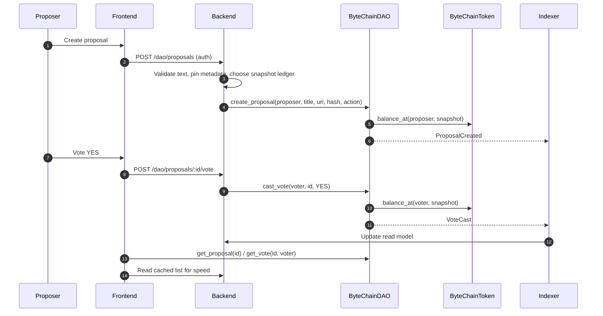
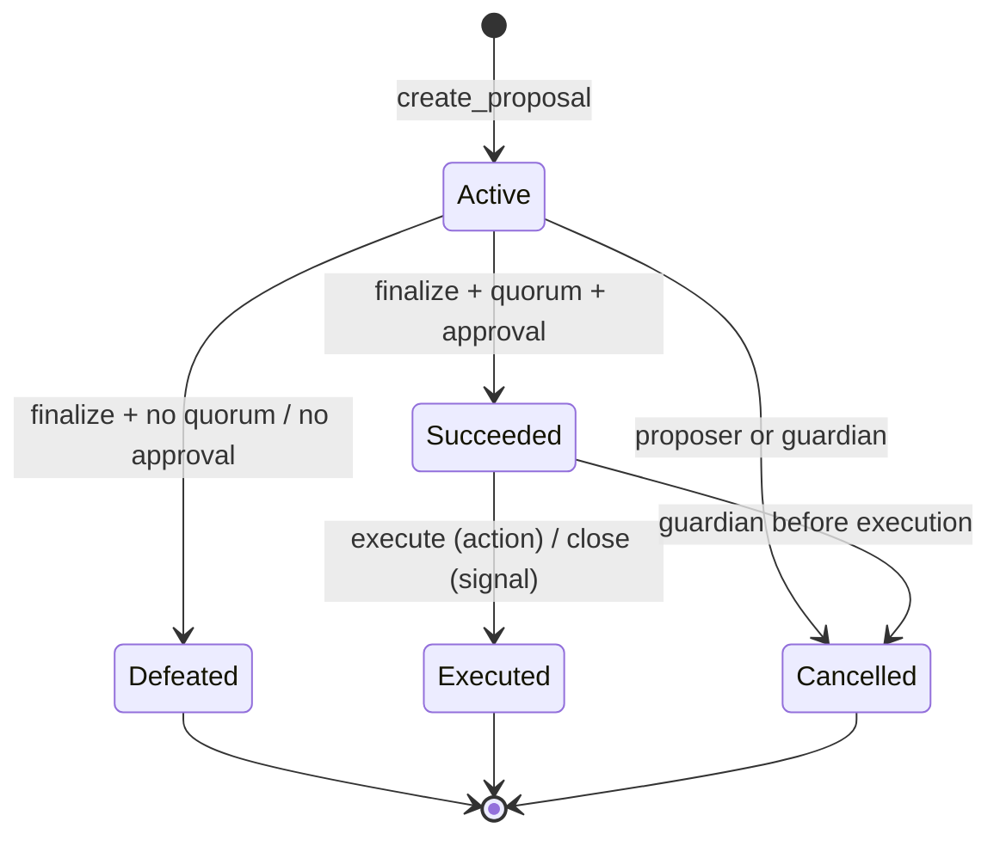

# Design: ByteChainDAO proposal and voting contract

| | |
|---|---|
| **Status** | Draft for review |
| **Author** | projectsfame |
| **Issue** | [#3](https://github.com/WeAcademy/bytechain-contracts/issues/3) |
| **Contract** | `ByteChainDAO` |
| **Target** | Stellar Soroban (Rust, `soroban-sdk` 29.x) |
| **Related** | ByteChainToken, ByteChainCertificate, backend `dao` module, `bytechain-indexer`, frontend DAO page |

---

## 1. Summary

`ByteChainDAO` ports the backend `dao` module to Soroban. It stores proposals,
records token-weighted votes and computes the final outcome according to a
snapshot, quorum and approval threshold. The backend remains the read model and
UI API, but the contract becomes the source of truth for proposal state and
votes.

This document maps the current off-chain behaviour to an on-chain lifecycle,
records the deliberate behaviour changes, and identifies the decisions that
need maintainer sign-off before implementation.

### Goals

- Create proposals with a title, description reference, category and voting
  window.
- Cast one vote per address (`YES`, `NO`, `ABSTAIN`) with voting power fixed at
  a proposal snapshot.
- Enforce quorum and approval thresholds deterministically on-chain.
- Finalise proposals without a privileged cron job.
- Optionally execute treasury transfers after a timelock.
- Emit events for the indexer and expose read-only views for the frontend.
- Keep proposal text off-chain (IPFS/HTTPS) with an on-chain hash commitment.

### Non-goals

- Writing course content or changing course state.
- Minting or transferring ByteChainToken (separate contract).
- Private voting or zero-knowledge tallying.
- Off-chain identity, XP calculation or user accounts.
- A general-purpose governance framework with arbitrary calldata in v1.
- Replacing the backend read API on day one.

---

## 2. Current backend behaviour

The existing module lives in
`bytechain-academy-backend/src/dao`:

| File | Behaviour |
|---|---|
| `entities/dao-proposal.entity.ts` | Status enum `ACTIVE`, `PASSED`, `REJECTED`, `WITHDRAWN`; title, description, proposer, deadline, yes/no/abstain counters |
| `entities/dao-vote.entity.ts` | Unique `(proposalId, voterId)`, vote type `YES`/`NO`/`ABSTAIN` |
| `dao.service.ts` | Creates proposals with a 7-day deadline; one vote per user; edits only before votes; owner can withdraw; daily cron finalisation |
| `dao.controller.ts` | Authenticated create/list/get/vote/edit/withdraw endpoints |
| `dto/*` | Title 10–200 chars, description 50–5000 chars, vote enum |

Behaviour to preserve:

- A proposal has a fixed voting deadline (7 days).
- A user can vote once; a second vote is a conflict.
- Votes are only accepted while the proposal is `ACTIVE` and before the
  deadline.
- Only the proposer can edit (before any votes) or withdraw an active proposal.
- Proposals are hidden from the default list when withdrawn.

Behaviour that must change on-chain:

| Backend behaviour | On-chain reason |
|---|---|
| Passes when `yesVotes > 50% of all registered users` | The contract cannot know the off-chain user count; use total voting power and an explicit quorum |
| Vote weight is always 1 | Token-weighted governance requires a balance/stake snapshot |
| Finalisation runs on a server cron | Anyone should be able to call `finalize` after the deadline |
| Tallies are incremented integers | Store per-voter weight and recompute/verify totals |
| Description stored in the database | Store a URI + hash on-chain; keep the text off-chain |
| `ACTIVE/PASSED/REJECTED/WITHDRAWN` | Add `SUCCEEDED`, `DEFEATED`, `CANCELLED`, `EXECUTED` for an explicit lifecycle |

**Important:** the current pass rule counts *all registered users* as the
denominator, including inactive accounts, and ignores `no` and `abstain` in the
threshold. That is neither a quorum nor a majority rule. The on-chain design
below replaces it with:

- **Quorum:** `yes + no >= quorum_bps * total_voting_power / 10_000`.
- **Approval:** `yes >= approval_bps * (yes + no) / 10_000`.
- `ABSTAIN` counts towards participation only if governance chooses to include
  it; the recommended default excludes it from both quorum and approval.

These parameters are configurable within bounds and must be published before
the first proposal.

---

## 3. Architecture context



**Responsibilities**

| Component | Responsibility |
|---|---|
| Backend | Auth, text validation, IPFS pinning, fee sponsorship, transaction submission, read cache |
| Frontend | Proposal UI, wallet connection, vote submission, status display |
| Contract | Proposal state, vote uniqueness, snapshot weights, quorum/threshold, execution |
| Token | Balance checkpoints / `balance_at(account, ledger)` and treasury transfers |
| Indexer | Events → backend read model, proposal/vote history |
| Admin/guardian | Config, emergency cancellation, upgrades (multisig + timelock) |

The backend should not be able to change a vote or outcome. It may only submit
transactions signed by the user (or sponsored) and cache the result.

---

## 4. Governance model

### 4.1 Voting power

Recommended v1: **staked ByteChainToken balance at a snapshot ledger**.

- At `create_proposal`, record `snapshot_ledger = current_ledger - 1` (or a
  configurable delay) so a proposer cannot buy tokens in the same ledger and
  immediately vote.
- `ByteChainToken` must expose `balance_at(account, ledger)` backed by
  checkpoints. If the token does not have checkpoints, the DAO can read the
  current balance at vote time, but that enables flash-loan/borrow voting and
  should not be used for real governance.
- Voting power is read once per voter and stored with the vote. Later transfers
  do not change a recorded vote.
- XP-linked stake is an alternative if XP is also checkpointed on-chain;
  otherwise it stays an off-chain signal.

Open decision: flat one-address-one-vote is simpler and resistant to token
borrowing, but easy to Sybil. Token-weighted voting matches the product vision
but needs checkpointing. The design assumes token-weighted voting; see §16.

### 4.2 Proposal thresholds

- `proposal_threshold`: minimum voting power at the snapshot to create a
  proposal (prevents spam).
- `proposal_deposit`: optional token deposit returned on finalisation or
  forfeited on cancellation. Prefer a threshold in v1 to avoid custody.
- Title max 100 bytes; description URI max 256 bytes; hash required.
- A proposer may have at most `max_active_proposals_per_address` (default 3).

### 4.3 Quorum and approval

```text
participating = yes_weight + no_weight          (ABSTAIN excluded by default)
quorum_ok     = participating * 10_000 >= quorum_bps * total_voting_power
approval_ok   = yes_weight * 10_000 >= approval_bps * participating
succeeded     = quorum_ok && approval_ok
```

- `quorum_bps` default 1_000 (10%).
- `approval_bps` default 5_001 (50.01%), avoiding a tie passing.
- Both are bounded: quorum 0–5_000, approval 5_001–10_000.
- `total_voting_power` is the token total supply at the snapshot, or a
  governance-set value if the token has locked/treasury balances that should be
  excluded. Document the choice; the simple default is total supply.
- If `participating == 0`, the proposal is defeated regardless of quorum.

### 4.4 Vote types

- `YES` — approves the proposal.
- `NO` — rejects it.
- `ABSTAIN` — counts as participation only if
  `config.abstain_counts_for_quorum` is true (default false). It never counts
  towards approval.
- One vote per address per proposal. Changing a vote is **not** supported in
  v1; it keeps tallying and indexer logic simple. A future `change_vote` can
  subtract the old weight and add the new one atomically.

---

## 5. Proposal lifecycle



| Status | Meaning |
|---|---|
| `ACTIVE` | Accepting votes until `end_ledger` |
| `SUCCEEDED` | Passed; waiting for execution or signal close |
| `DEFEATED` | Failed quorum or approval |
| `CANCELLED` | Withdrawn by proposer or emergency-cancelled by guardian |
| `EXECUTED` | Action executed (or signal marked closed) |

Rules:

- `create_proposal` starts at `ACTIVE` immediately, matching the backend.
- `finalize` is permissionless after `end_ledger`; it is idempotent and returns
  the existing terminal status on repeat calls.
- A signal proposal moves `SUCCEEDED -> EXECUTED` via `execute`, which only
  marks it closed and emits an event. It does not call another contract.
- A treasury proposal moves `SUCCEEDED -> EXECUTED` only after
  `execution_delay_ledgers`; the guardian can cancel during the delay.
- A proposer can cancel only while `ACTIVE` and before any votes, matching the
  backend's "edit before votes" spirit; the guardian can cancel in an emergency
  with a reason and event.
- There is no `WITHDRAWN` state separate from `CANCELLED`; the cancellation
  reason distinguishes proposer withdrawal from an emergency.

---

## 6. Contract interface

```rust
#[contract]
pub struct ByteChainDAO;

#[contractimpl]
impl ByteChainDAO {
    /// admin, token contract and initial config.
    pub fn __constructor(env: Env, admin: Address, token: Address, config: Config);

    // ---- proposals ------------------------------------------------------
    pub fn create_proposal(
        env: Env,
        proposer: Address,
        title: String,
        description_uri: String,
        description_hash: BytesN<32>,
        category: ProposalCategory,
        action: ProposalAction,
    ) -> Result<u64, Error>;

    pub fn cancel_proposal(
        env: Env,
        caller: Address,
        proposal_id: u64,
        reason: String,
    ) -> Result<(), Error>;

    // ---- voting ---------------------------------------------------------
    pub fn cast_vote(
        env: Env,
        voter: Address,
        proposal_id: u64,
        support: VoteType,
    ) -> Result<u64, Error>; // returns recorded weight

    pub fn finalize(env: Env, proposal_id: u64)
        -> Result<ProposalStatus, Error>;

    pub fn execute(env: Env, caller: Address, proposal_id: u64)
        -> Result<(), Error>;

    // ---- configuration --------------------------------------------------
    pub fn set_config(env: Env, admin: Address, config: Config)
        -> Result<(), Error>;
    pub fn propose_upgrade(env: Env, admin: Address, wasm_hash: BytesN<32>)
        -> Result<u64, Error>;
    pub fn execute_upgrade(env: Env, admin: Address, proposal_id: u64)
        -> Result<(), Error>;

    // ---- read-only views ------------------------------------------------
    pub fn get_proposal(env: Env, proposal_id: u64) -> Option<Proposal>;
    pub fn get_vote(env: Env, proposal_id: u64, voter: Address)
        -> Option<Vote>;
    pub fn has_voted(env: Env, proposal_id: u64, voter: Address) -> bool;
    pub fn proposal_count(env: Env) -> u64;
    pub fn voting_power(env: Env, account: Address, snapshot_ledger: u32)
        -> i128;
    pub fn get_config(env: Env) -> Config;
    pub fn version(env: Env) -> u32;
}
```

`ProposalAction`:

```rust
#[contracttype]
pub enum ProposalAction {
    Signal,
    TreasuryTransfer {
        asset: Address,        // token contract (BCT or Stellar asset)
        recipient: Address,
        amount: i128,
    },
}

#[contracttype]
#[derive(Clone, Debug, Eq, PartialEq)]
pub enum ProposalStatus {
    Active,
    Succeeded,
    Defeated,
    Cancelled,
    Executed,
}

#[contracttype]
#[derive(Clone, Debug, Eq, PartialEq)]
pub enum VoteType {
    Yes,
    No,
    Abstain,
}

#[contracttype]
#[derive(Clone, Debug, Eq, PartialEq)]
pub enum ProposalCategory {
    Curriculum,
    Treasury,
    Partnership,
    Governance,
    Other,
}

#[contracttype]
#[derive(Clone, Debug, Eq, PartialEq)]
pub struct UpgradeProposal {
    pub id: u64,
    pub wasm_hash: BytesN<32>,
    pub proposed_at: u64,
    pub execute_after: u32, // ledger sequence
    pub executed: bool,
}
```

Arbitrary `ContractCall { contract, function, args }` is intentionally deferred:
it turns a governance bug into arbitrary code execution against the treasury and
every integrated contract. If it is added later, use a whitelist of target
contracts/functions, an execution timelock and a security review.

---

## 7. Data model and storage

```rust
#[contracttype]
#[derive(Clone, Debug, Eq, PartialEq)]
pub struct Proposal {
    pub id: u64,
    pub proposer: Address,
    pub title: String,
    pub description_uri: String,
    pub description_hash: BytesN<32>,
    pub category: ProposalCategory,
    pub status: ProposalStatus,
    pub created_at: u64,
    pub start_ledger: u32,
    pub end_ledger: u32,
    pub snapshot_ledger: u32,
    pub yes_weight: i128,
    pub no_weight: i128,
    pub abstain_weight: i128,
    pub total_voting_power: i128,
    pub action: ProposalAction,
    pub action_hash: BytesN<32>,
    pub executed_at: Option<u64>,
    pub cancelled_at: Option<u64>,
    pub cancel_reason: Option<String>,
}

#[contracttype]
#[derive(Clone, Debug, Eq, PartialEq)]
pub struct Vote {
    pub voter: Address,
    pub support: VoteType,
    pub weight: i128,
    pub cast_at: u64,
}

#[contracttype]
pub struct Config {
    pub voting_period_ledgers: u32,
    pub execution_delay_ledgers: u32,
    pub quorum_bps: u32,
    pub approval_bps: u32,
    pub proposal_threshold: i128,
    pub max_active_proposals: u32,
    pub abstain_counts_for_quorum: bool,
}
```

Storage keys:

| Key | Storage | Value |
|---|---|---|
| `DataKey::Admin` | instance | `Address` |
| `DataKey::Token` | instance | `Address` |
| `DataKey::Config` | instance | `Config` |
| `DataKey::NextProposalId` | instance | `u64` |
| `DataKey::Version` | instance | `u32` |
| `DataKey::Proposal(u64)` | persistent | `Proposal` |
| `DataKey::Vote(u64, Address)` | persistent | `Vote` |
| `DataKey::ActiveProposals(Address)` | persistent | `u32` (proposer quota) |
| `DataKey::Executed(u64)` | persistent | `bool` (idempotency) |
| `DataKey::UpgradeProposal(u64)` | persistent | `UpgradeProposal` |

- Store the typed `action` so `execute` knows the recipient and amount, and
  store `action_hash` as SHA-256 over the serialised action for events/audit. For
  signal proposals the hash covers an empty payload.
- Use persistent storage for proposals/votes and bump TTLs on writes. Active
  proposals should be checked by the finalizer before they archive; a keeper can
  bump long-lived historical proposals. Never use temporary storage.
- Description text lives off-chain; `description_uri` must be `ipfs://` or
  `https://` and `description_hash` must match.

---

## 8. Authorization and timing

| Action | Who | Auth / rule |
|---|---|---|
| Create proposal | Proposer | `proposer.require_auth()` + balance ≥ threshold + quota |
| Cast vote | Voter | `voter.require_auth()` + weight > 0 + within window |
| Finalize | Anyone | No auth; only after `end_ledger`; idempotent |
| Execute signal | Anyone | After success; marks executed |
| Execute treasury transfer | Anyone (keeper) | After success + execution delay; guardian not cancelled |
| Cancel active proposal | Proposer | Before any votes; `proposer.require_auth()` |
| Emergency cancel | Guardian | `guardian.require_auth()`; reason + event; delay for success stage |
| Set config | Admin | Multisig + timelock; bounds enforced |
| Upgrade | Admin | Multisig + timelock; WASM hash pinned |

Timing uses ledger sequence, not wall-clock time:

- `start_ledger = env.ledger().sequence()`.
- `end_ledger = start_ledger + config.voting_period_ledgers` (default ~7 days at
  ~5 seconds per ledger ≈ 120_960 ledgers).
- `snapshot_ledger = start_ledger - 1` (or `start_ledger - snapshot_delay`).
- Execution delay default 2 days ≈ 34_560 ledgers.

Using ledgers keeps behaviour deterministic across testnet and mainnet. The API
can still display an estimated date.

---

## 9. Outcomes and tallying

`finalize`:

1. Load proposal; if not `ACTIVE`, return its status (idempotent).
2. Require `env.ledger().sequence() > end_ledger`.
3. Read `yes_weight`, `no_weight`, `abstain_weight` and `total_voting_power`
   from the proposal (recorded at creation/vote time).
4. Compute quorum and approval as in §4.3.
5. Set `SUCCEEDED` or `DEFEATED`; emit `ProposalFinalized`.
6. Release the proposer's active-proposal slot.

`execute`:

1. Require `status == SUCCEEDED`.
2. For `Signal`, set `EXECUTED` and return.
3. For `TreasuryTransfer`, require the execution delay has passed, mark
   `EXECUTED` **before** the external call (checks-effects-interactions), then
   call the token contract to transfer from the DAO treasury to the recipient.
4. Emit `ProposalExecuted`.
5. If the token call fails, revert the whole transaction (Soroban is atomic), so
   the proposal stays unexecuted and can be retried.

`cancel` during `SUCCEEDED` (guardian) must be timelocked or require a second
guardian signature to prevent a single key from blocking passed proposals.

---

## 10. Events

| Event | Topics | Data |
|---|---|---|
| `ProposalCreated` | `("proposal_created", proposer)` | `proposal_id`, `category`, `end_ledger`, `snapshot_ledger`, `action_hash` |
| `VoteCast` | `("vote_cast", voter)` | `proposal_id`, `support`, `weight` |
| `ProposalFinalized` | `("proposal_finalized",)` | `proposal_id`, `status`, `yes`, `no`, `abstain`, `total_power` |
| `ProposalExecuted` | `("proposal_executed",)` | `proposal_id`, `executor`, `action_hash` |
| `ProposalCancelled` | `("proposal_cancelled",)` | `proposal_id`, `caller`, `reason` |
| `ConfigUpdated` | `("config_updated",)` | old/new quorum, approval, voting period |
| `UpgradeProposed` | `("upgrade_proposed",)` | `upgrade_id`, `wasm_hash`, `execute_after` |
| `Upgraded` | `("upgraded",)` | `upgrade_id`, `wasm_hash` |

`weight` and tallies are `i128` in events; the indexer should store them as
strings/decimals to avoid JavaScript number precision loss above 2^53.

Event data must not contain proposal text or PII; use ids/hashes.

---

## 11. Errors

```rust
#[contracterror]
#[derive(Copy, Clone, Debug, Eq, PartialEq, PartialOrd, Ord)]
#[repr(u32)]
pub enum Error {
    AlreadyInitialized = 1,
    NotAuthorized = 2,
    ProposalNotFound = 3,
    VotingClosed = 4,
    VotingNotStarted = 5,
    AlreadyVoted = 6,
    NoVotingPower = 7,
    ProposalThresholdNotMet = 8,
    TooManyActiveProposals = 9,
    InvalidTitle = 10,
    InvalidDescription = 11,
    InvalidAction = 12,
    InvalidConfig = 13,
    NotActive = 14,
    NotSucceeded = 15,
    AlreadyFinalized = 16,
    ExecutionDelayNotMet = 17,
    AlreadyExecuted = 18,
    Cancelled = 19,
    UpgradeNotReady = 20,
    InvalidSnapshot = 21,
}
```

---

## 12. Security considerations

- **Flash-loan / borrow voting.** Snapshot voting power at a ledger before the
  proposal opens. If the token cannot answer historical balances, do not launch
  token-weighted governance; use a staking contract with checkpoints.
- **Vote buying.** Token-weighted voting is inherently purchasable; snapshotting
  and a voting delay reduce last-minute manipulation but do not eliminate it.
  Document this as a known property.
- **Sybil resistance.** One address = one vote is worse without identity; token
  weight is the chosen sybil cost. Proposal thresholds also deter spam.
- **Proposer spam.** Minimum balance, active-proposal quota and a small deposit
  (optional) bound state growth.
- **Quorum manipulation.** Publish `total_voting_power` at the snapshot and make
  it immutable per proposal. Do not recompute it at finalisation.
- **Treasury execution.** Mark executed before the external call; restrict
  actions to a typed enum; timelock; guardian cancellation with a reason.
  Soroban's atomic transactions mean a failed transfer reverts cleanly.
- **Admin/guardian compromise.** Multisig + timelock, separate keys, monitoring,
  and a published upgrade hash. A guardian should not be able to pass a
  proposal, only cancel one.
- **Upgrade risk.** Storage versioning, additive changes, audited WASM, pinned
  hash and a migration function. See §10 of the certificate design for the same
  pattern.
- **Description phishing.** The UI must display the pinned text and hash, and
  warn when the URI/hash cannot be verified. Never render raw HTML from IPFS.
- **Archival.** Active proposals can archive if nobody bumps TTL; the finalizer
  and keeper should bump active proposals. Treat `None` as unknown, not
  defeated.
- **Indexer lag.** The UI should label cached data and link to the transaction;
  a vote is not final until the contract transaction succeeds.
- **Precision.** Use `i128` on-chain and strings in JSON; never rely on
  JavaScript `number` for token amounts.

---

## 13. Migration from the backend module

Recommended path:

1. Keep the current backend endpoints and database as a read model while the
   contract is developed.
2. Deploy the token with balance checkpoints first; without it, snapshot voting
   is not possible.
3. Deploy `ByteChainDAO` on testnet, run a shadow period where proposals are
   created on both systems and tallies are compared.
4. At a published cutover ledger:
   - Stop creating/voting in the backend.
   - Mark existing proposals as `ARCHIVED` in the read model (do not rewrite
     their outcomes).
   - Create new proposals on-chain only.
5. The backend keeps a mapping `legacy_proposal_id -> onchain_proposal_id` for
   links and analytics.
6. Backfill is not recommended for old votes: importing tally numbers without
   per-voter proofs creates an unauditable record. Archive them read-only and
   start on-chain governance fresh.

If maintainers require historical proposals on-chain, add a one-shot
`import_legacy` admin function that stores a `LegacyResult` with a published
snapshot hash and no voting rights. Do not fabricate per-address votes.

---

## 14. Testing strategy

### Unit tests

- Constructor rejects a second initialisation and invalid config.
- Create proposal: auth, threshold, quota, title/URI/hash validation, category,
  snapshot/end ledgers, event.
- Cast vote: auth, window, zero weight, duplicate, each vote type, weight
  recorded, tallies update.
- Finalize: before deadline fails; no participation defeats; quorum boundary;
  approval boundary (exactly 50%, 50.01%); abstain excluded/included by config;
  idempotency; proposer quota released.
- Cancel: proposer before votes; proposer after votes fails; guardian during
  active/succeeded; reason/event.
- Execute: signal closes; treasury transfer before delay fails; after delay
  succeeds; double execute fails; failed token call leaves state unexecuted.
- Config: bounds, admin auth, event, timelock.
- Upgrade: propose/execute delay, hash, version migration.
- Views: unknown ids, has_voted, voting_power at snapshot.

### Property / fuzz tests

- Sum of recorded vote weights equals each tally.
- A voter cannot have two vote records.
- `proposal_count` increases monotonically.
- Status transitions follow the state machine only.
- Quorum/approval results match an independent reference implementation for
  random tallies.

### Integration tests

1. Deploy token with checkpoints and DAO to testnet.
2. Mint/distribute tokens, create a proposal, vote from multiple accounts,
   finalize, execute a treasury transfer.
3. Confirm the indexer receives and persists every event.
4. Confirm the frontend read model matches `get_proposal` after each step.
5. Exercise the guardian cancel path and a failed execution/retry.
6. Measure instruction/fee cost and test with maximum title/URI lengths.

### CI

`cargo fmt --check`, `cargo clippy -- -D warnings`, `cargo test`,
`stellar contract build`, plus the shared workspace CI from the contracts
scaffold. External audit before mainnet.

---

## 15. Deployment and operations

- **Admin:** Stellar multisig account; guardian a separate multisig or security
  council.
- **Token:** deploy and checkpoint before the DAO; record the token contract id
  in the DAO constructor.
- **Config publication:** publish quorum, approval, voting period, execution
  delay and thresholds in the README and UI before the first proposal.
- **Fee sponsorship:** the backend can sponsor proposal/vote transactions so
  learners do not need XLM; the signer still authorises the vote.
- **Monitoring:** proposal creation rate, vote failures, finalisation lag,
  execution failures, quorum near-misses, admin/guardian actions, archived
  proposals.
- **Runbook:** create/cancel proposal, finalize, execute, change config,
  upgrade, pause (disable creation via config or remove token), and recover from
  RPC/indexer outages.
- **Upgrade:** timelock, published WASM hash, storage migration, testnet
  rehearsal.

---

## 16. Open questions

1. **Voting power:** staked BCT balance at a snapshot, raw BCT balance, or
   XP-linked stake? This determines whether the token needs checkpoints.
2. **Delegation:** should holders be able to delegate voting power? It adds a
   delegation registry and event surface.
3. **Quorum denominator:** total supply, circulating supply, or a governance-set
   `total_voting_power` that excludes treasury/locked tokens?
4. **Quorum/approval defaults:** confirm 10% quorum and 50.01% approval, and
   whether `ABSTAIN` counts towards quorum.
5. **Proposal actions:** is v1 signal + treasury transfer enough, or is a
   whitelisted contract-call action required at launch?
6. **Proposer threshold/deposit:** what minimum balance or deposit prevents
   spam without excluding small holders?
7. **Cancellation:** should the proposer be able to cancel after votes if a
   majority agrees? Should the guardian be able to cancel a succeeded proposal
   during the timelock?
8. **Vote changes:** allow changing a vote before the deadline (subtract/add
   weight) or keep one immutable vote?
9. **Upgradeability:** admin multisig + timelock, or an immutable contract with
   a migration contract?
10. **Historical migration:** archive old backend proposals read-only, or
    import tallies as non-voting legacy results?
11. **Privacy:** is public voting acceptable, or is a commit-reveal scheme
    needed for sensitive proposals?
12. **Fee sponsorship:** should the platform pay all governance fees, and who
    funds it?

---

## 17. Implementation plan

1. Finalise the governance parameters and token checkpoint design (§16).
2. Scaffold `contracts/bytechain-dao` in the Rust workspace.
3. Implement `Proposal`, `Vote`, `Config`, storage keys and errors.
4. Implement create/cancel with threshold, quota and validation.
5. Implement cast_vote with snapshot weight and duplicate protection.
6. Implement finalize with quorum/approval and idempotency.
7. Implement execute for signal and treasury transfer with timelock.
8. Add admin config, upgrade proposal/execute and migration hooks.
9. Add unit, property and testnet integration tests.
10. Update the backend to submit transactions and the indexer to build the read
    model; update the frontend to read contract state.
11. Audit, pin the WASM hash and deploy behind a published cutover ledger.

---

## 18. References

- Backend DAO module: `bytechain-academy-backend/src/dao`
- Backend certificate flow: `bytechain-academy-backend/src/certificates`
- Soroban SDK: <https://docs.rs/soroban-sdk>
- Stellar smart contracts: <https://developers.stellar.org/docs/smart-contracts>
- SEP-41 token interface: <https://github.com/stellar/stellar-protocol/blob/master/ecosystem/sep-0041.md>
- ByteChain contracts repository: <https://github.com/WeAcademy/bytechain-contracts>
- ByteChainToken design (reward token): see the contracts repository docs
